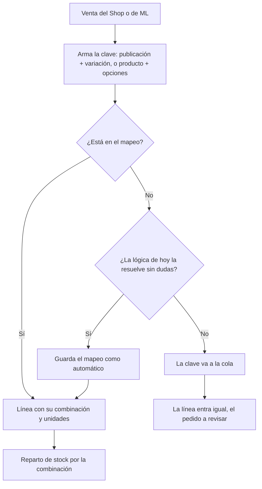

# SDD funcional · Mapeo de productos entre sistemas

## 1. Objetivo
Que "lo que se vendió" sea siempre la misma cosa, entre por donde entre. Hoy el Shop, Mercado
Libre y la carga manual describen cada venta con texto y el ERP la reconstruye adivinando:
editar un pedido le borra la funda para el reparto, 21 productos del Shop no tienen par en el
ERP, la funda tiene tres nombres, un "pack de 10" se lee como una variante. Con esta feature el
ERP conoce cada **combinación vendible** (con su SKU), cada canal se mapea **una vez** a esas
combinaciones, y lo que no se pudo mapear espera en una cola en vez de entrar mal en silencio.

Y una katana nueva se arma sin ayuda: la pieza nace en Bodega, aparece sola en el ERP, y ahí se
elige qué funda lleva. Hasta hoy esa receta se cargaba con scripts.

El análisis con todas las mediciones está en el cerebro: `Mapeo de productos`.

## 2. Actores y permisos
| Actor | Qué puede hacer en esta feature |
|---|---|
| Agustín (cuenta del negocio) | Ver y editar combinaciones, mapear la cola, elegir combinaciones al cargar o editar un pedido |
| Cuenta demo | Ve las combinaciones de su catálogo; no ve Integraciones, como hoy |
| Webhooks de ML y del Shop | Resuelven cada venta con el mapeo; agregan a la cola lo que no conocen |

## 3. Flujos

### 3.1 Entra una venta

### 3.2 Mapear la cola
1. En Integraciones › Mapeo, la cola muestra cada clave sin mapear: canal, título, opciones,
   cuántas veces se vio y la última venta.
2. Se elige la combinación (buscando por nombre o SKU), o se crea (modelo + variantes), y las
   unidades si es un pack. O se marca "otro negocio".
3. Al guardar, los pedidos abiertos que entraron con esa clave quedan con su combinación, su costo
   y su stock repartido.

### 3.3 Crear una katana nueva
1. Se crea la pieza en Bodega (como siempre). El ERP la da de alta sola, con su fila de stock.
2. En el modelo, "Agregar accesorio" → Funda: el ERP crea "Con Funda" y "Sin Funda" y sus
   combinaciones, con su SKU.
3. Se elige la funda de la lista (las fundas son insumos). Listo: "Con Funda" reserva la hoja y
   la funda; "Sin Funda", sólo la hoja.
4. Las publicaciones de ML y el producto del Shop de esa katana caen en la cola de mapeo la
   primera vez que se venden (o antes, si se siembran), y se enlazan una vez.

### 3.4 Cargar o editar un pedido a mano
1. En el diálogo de pedido, cada línea elige una **combinación** (buscando por nombre o SKU), no un
   modelo más casillas.
2. Abrir y guardar sin tocar no cambia nada.

## 4. Reglas de negocio
- **RN-1** — El SKU de una combinación es el del modelo más un sufijo por variante
  (`SS-DEM-KAT-006-95-CF`). Se asigna una vez y no cambia.
- **RN-2** — Nunca se pierde una línea: lo que no se puede mapear entra igual y el pedido queda a
  revisar.
- **RN-3** — Ningún número cambia por esta feature: precios, costos y reservas dan lo mismo que
  antes. El reparto nuevo se compara en sombra contra el actual hasta que den igual.
- **RN-4** — Bodega no cambia: sus piezas siguen enlazadas a las filas de stock como hoy.
- **RN-5** — Un insumo (funda, exhibidor) no limita la venta: si falta, el pedido entra igual y
  el insumo aparece para imprimir.
- **RN-6** — Variantes que son la misma pieza (los integrantes del vaso BTS, los personajes del
  llavero BT21) son combinaciones distintas que consumen **una sola** fila de stock. Variantes
  que son piezas distintas (los diseños de la jabonera) tienen una fila cada una.

## 5. Pantallas
| Pantalla | Quién la ve | Qué muestra | Qué permite |
|---|---|---|---|
| `/modelos/[id]` | Cuenta del negocio y demo | Las combinaciones del modelo, con SKU y lo que consume cada una (pieza + insumos) | Crear o desactivar una combinación, completar el sufijo, "Agregar accesorio", elegir o cambiar el insumo |
| `/integraciones` › Mapeo (pestaña nueva) | Cuenta del negocio | La cola y todos los mapeos por canal | Mapear, crear combinación, unidades, otro negocio |
| Diálogo de pedido | Cuenta del negocio y demo | Una combinación por línea | Elegir la combinación |
| `/modelos` | Igual que hoy | Suma un contador de combinaciones sin SKU y de recetas pendientes | — |

## 6. Specs
| Spec | Qué define |
|---|---|
| [001-combinacion-vendible](specs/001-combinacion-vendible.md) | La combinación, su SKU y la siembra |
| [002-reparto-por-combinacion](specs/002-reparto-por-combinacion.md) | El reparto lee la combinación, verificado antes en sombra |
| [003-linea-con-combinacion](specs/003-linea-con-combinacion.md) | La línea guarda la combinación; diálogo y backfill |
| [004-mapeo-por-canal](specs/004-mapeo-por-canal.md) | El mapeo de ML y del Shop, la cola y su pantalla |
| [005-cambios-en-el-shop](specs/005-cambios-en-el-shop.md) | El Shop manda ids de producto y opciones (lo hace su sesión) |
| [006-recetas-desde-el-erp](specs/006-recetas-desde-el-erp.md) | Qué consume cada combinación, y "Agregar accesorio", desde el ERP |

## 7. Fuera de alcance
- Costo propio por combinación desde las piezas de Bodega (retirar base + adicional): otra
  feature, que se apoya en esta.
- Escribir SKUs en las publicaciones de ML o en el Shop.
- Que el Shop deje de autogenerar SKUs.
- Llevar la disponibilidad a los canales: es la **feature 002** (abajo, sección 8), que se apoya
  en esta.
- Ejes de variantes y combinaciones de más de un eje automáticas.

## 8. Dependencias
- Fase 0, ya hecha el 2026-10-18 (sin commitear): el bug de `normalizeVariante` y que el diálogo no
  pierda el `varianteId` (`src/lib/variantes-item.ts`).
- Spec 005 la implementa la sesión del Shop. El ERP no depende de ella para arrancar: usa la clave
  por SKU y nombres hasta que lleguen los ids.
- **Feature 002 (después de esta): disponibilidad en los canales.** Pedido de Agustín
  (2026-10-18): cuando el ERP marque que algo se quedó sin stock, que en la web pase a
  "disponible X días después de la compra" y que en ML se le desactive Flex y se le sumen 2 días
  de disponibilidad; y al revés cuando vuelve el stock. Así no se pausa ni se corta la venta.
  Necesita esta feature: sin el mapeo no se sabe qué publicación corresponde a qué pieza.

## 9. Decisiones tomadas
| Fecha | Decisión | Por qué | Quién |
|---|---|---|---|
| 2026-10-18 | SKU de la combinación = SKU del modelo + sufijo por eje | Compatible con lo cargado en el Shop y en ML | Agustín |
| 2026-10-18 | El mapeo de cada canal vive en el ERP | El Shop sólo agrega ids y ML no se toca | Agustín |
| 2026-10-18 | La fase 0 se hizo antes del SDD | Frena el daño mientras tanto | Agustín |
| 2026-10-18 | El reparto pasa a la combinación recién con la comparación en sombra en cero | Las reservas son lo más delicado; un error ahí no se ve hasta armar el paquete | Agente |
| 2026-10-18 | Sin tabla de componentes por ahora | `stock.clave` + `reglas_insumo` ya resuelven la receta; no hay que cargar nada nuevo | Agente |
| 2026-10-18 | La clave de ML es publicación + `variation_id` | Es estable aunque ML renombre el atributo, y viene en cada orden | Agente |
| 2026-10-18 | Vaso BTS y llavero BT21: variantes que comparten una fila de stock; jabonera: una fila por diseño | Así se fabrican: el vaso y la base del llavero son los mismos, cada jabonera es otra impresión | Agustín |
| 2026-10-18 | El exhibidor de la Kitetsu es un insumo, como la funda | Se imprime aparte y se descuenta de su propio stock | Agustín |
| 2026-10-18 | Se suma la spec 006: recetas desde el ERP | Crear una katana necesitaba scripts para la funda | Agustín |
| 2026-10-18 | La disponibilidad en los canales va en la feature 002, no en esta | Depende del mapeo, y tocar ML necesita su propia decisión (la integración era de sólo lectura) | Agente |

## 10. Preguntas abiertas
Ninguna. La de los diseños y las firmas se respondió el 2026-10-18 (spec 004, RN-8).
