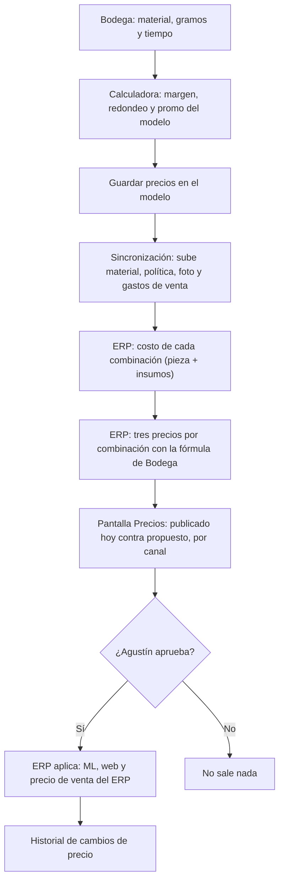

# SDD funcional · Precios desde Bodega

## 1. Objetivo
Que el precio de cada cosa se decida en un solo lugar, Bodega, y llegue a la web, a Mercado
Libre y al ERP sin copiarlo a mano. Hoy la calculadora de Bodega calcula los tres precios (ML,
web y personalizados) pero el número se copia publicación por publicación, se olvida, y no queda
registro. Con esto: se costea en Bodega con el material real, se elige margen y redondeo por
modelo, el ERP calcula el precio de cada combinación que se vende (con su funda, su exhibidor o
su pack) y muestra qué cambiaría en cada canal; Agustín aprueba y el ERP lo aplica.

## 2. Actores y permisos
| Actor | Qué puede hacer en esta feature |
|---|---|
| Agustín en Bodega | Cargar materiales y su precio; costear; elegir margen, redondeo y promo por modelo; guardar los precios |
| Agustín en el ERP | Ver la propuesta por canal, leer los precios publicados, aplicar; ver el historial |
| Cuenta demo del ERP | Nada: la pantalla de Precios no es de la demo |
| Sesión del Shop | Implementar el endpoint de precios (spec 006) |

## 3. Flujos

### 3.1 De Bodega a los canales

### 3.2 Un día normal
1. Sube el filamento: Agustín cambia el precio del material en Bodega.
2. En la próxima sincronización el ERP recalcula costos y precios.
3. Agustín abre Precios, toca "Leer precios actuales", filtra "con diferencias".
4. Revisa, aplica ML y web; lo que no se pudo aplicar dice por qué.

## 4. Reglas de negocio
- **RN-1** — Ningún precio sale solo: ni al guardar en Bodega, ni por un cron (decisión del
  2026-10-20).
- **RN-2** — El precio se decide en Bodega; el ERP lo calcula para cada combinación con la misma
  fórmula y los costos de hoy. No se edita a mano en la pantalla de Precios.
- **RN-3** — En ML se cambia sólo el precio, nunca otro campo de la publicación.
- **RN-4** — El precio de venta del ERP (pedidos a mano) es el de personalizados.

## 5. Pantallas
| Pantalla | Quién la ve | Qué muestra | Qué permite |
|---|---|---|---|
| Bodega › Configuración › Materiales y precio por kilo (sección nueva) | Agustín | Materiales con su precio por kg y cuántos modelos los usan | Agregar, cambiar precio, elegir el por defecto, desactivar |
| Bodega › Calculadora | Agustín | Lo de hoy + material, y la política del modelo | "Guardar precios en el modelo" |
| Bodega › Ficha del modelo | Agustín | Los tres precios con la fórmula nueva (sale el × 1,8) | Elegir material |
| ERP › Precios (nueva) | Agustín | Por combinación: costo, tres precios, foto de Bodega; por canal: publicado y propuesto | Leer precios actuales, filtrar, aplicar por fila, selección o canal |

## 6. Specs
| Spec | Qué define |
|---|---|
| [001-catalogo-de-materiales](specs/001-catalogo-de-materiales.md) | Precio por material, elegido por modelo, en Bodega y en el ERP |
| [002-politica-de-precio-por-modelo](specs/002-politica-de-precio-por-modelo.md) | Margen, redondeo y promo por modelo; guardar precios; gastos de venta al ERP |
| [003-precio-de-cada-combinacion](specs/003-precio-de-cada-combinacion.md) | El ERP calcula los tres precios de cada combinación; precio de venta del ERP |
| [004-pantalla-de-precios](specs/004-pantalla-de-precios.md) | Propuesta, diferencias, aprobación e historial |
| [005-precios-en-mercado-libre](specs/005-precios-en-mercado-libre.md) | Escribir sólo el precio en ML, con sus restricciones |
| [006-cambios-en-el-shop](specs/006-cambios-en-el-shop.md) | El endpoint del Shop que traduce precios por combinación (lo hace su sesión) |

## 7. Fuera de alcance
- Disponibilidad en los canales (sin stock → "disponible X días después", Flex): feature 002.
- Promociones de ML (crearlas o terminarlas).
- Precios automáticos o con tope (descartado el 2026-10-20).

## 8. Dependencias
- **SDD 001 (mapeo de productos):** los precios llegan a cada canal por `mapeos_canal`. Para ML
  hay que vaciar la cola (27 claves al 2026-10-20). Para la web hace falta la siembra del Shop
  (TASK-013 de la 001), que espera las respuestas de TASK-022 (catálogo del Shop).
- **Bodega:** una release con las specs 001 y 002, instalada en el taller.
- **Shop:** la spec 006, hecha por su sesión.

## 9. Decisiones tomadas
| Fecha | Decisión | Por qué | Quién |
|---|---|---|---|
| 2026-10-20 | El ERP calcula el precio de cada combinación; Bodega guarda la política por modelo y una foto | Bodega conoce piezas, no combinaciones; la fórmula ya trata los insumos aparte, así que el número es exacto | Agustín |
| 2026-10-20 | Se aplica sólo con aprobación en el ERP | Son cambios que ve el cliente; un error de costo no puede salir solo | Agustín |
| 2026-10-20 | El precio de venta del ERP sigue al de personalizados | Es el precio de los pedidos a mano, sin comisiones | Agustín |
| 2026-10-20 | El catálogo de materiales entra primero en esta feature | El precio sale del costo: con un solo precio de filamento el precio publicado sale mal | Agustín |
| 2026-10-20 | ML deja de ser sólo lectura **para el precio** | Lo pidió Agustín para controlar precios desde Bodega; el resto de la publicación sigue intocable | Agustín |
| 2026-10-20 | El catálogo de materiales vive en Bodega y sube al ERP; la tabla `filamentos` del ERP no se reusa | Los precios se controlan desde Bodega; esa tabla está abandonada (una fila de marzo) | Agente |
| 2026-10-20 | La fórmula de precios se copia en el ERP, con un chequeo que avisa si se desfasa de la de Bodega | Son dos apps sin código compartido; es el mismo criterio que `fabricacionDeReceta` | Agente |

## 10. Preguntas abiertas
Ninguna.
