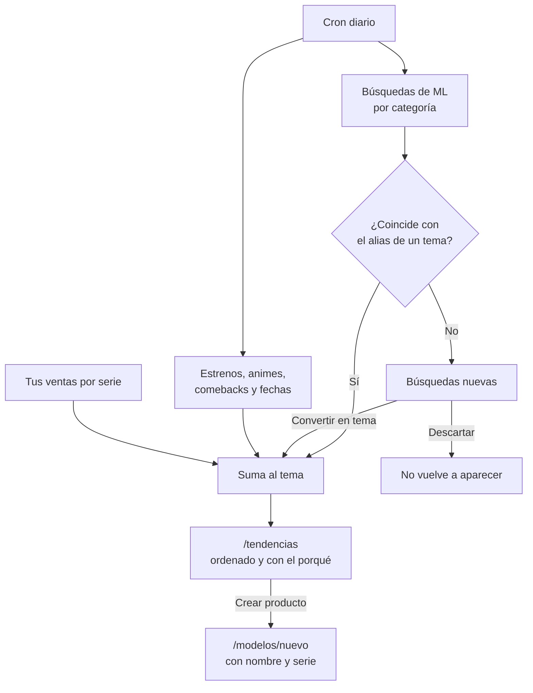

# SDD funcional · Tendencias por tema

## 1. Objetivo

Agustín, el 2026-11-20: "Mirá la sección de tendencias que tenemos ahora, ¿hay chances de
mejorarla? Con la nueva interfaz que hacemos y eso. Además, si hay mejores APIs para consumir de
tendencias, ya sea conciertos en Argentina, animes, películas, kpop, canciones de bandas de kpop".

Hoy Tendencias es una lista de estrenos del mundo con sugerencias de plantilla. Cuando esto esté en
producción, la pantalla contesta **qué conviene hacer ahora**, mirando tres cosas juntas:
- lo que la gente **busca esta semana en Mercado Libre Argentina**;
- lo que **viene** (estrenos en Argentina, temporadas de anime, comebacks, recitales, fechas comerciales);
- lo que **ya vendés** y si está subiendo o bajando.

Todo se ordena por **tema** (JOJO, K4os, Demon Slayer, Labubu…), que es como piensa el negocio, y
cada tema lleva a sus productos o a crear uno nuevo.

### Cómo está hoy (2026-11-20)

| | Qué hay | El problema |
|---|---|---|
| Animes (AniList) | 153, de los que 9 son futuros | Todos figuran como activos |
| Películas y series (TMDB) | 71, de las que 9 son futuras | Popularidad mundial; la fecha es la del primer estreno en el mundo, no la de Argentina |
| Fechas comerciales | 14 cargadas a mano, sólo 2026; quedan 4 | 2027 no existe |
| Conciertos | 1 cargado a mano, ya pasado | No hay fuente |
| K-pop y música | Nada | |
| Sugerencias | 262, con sólo 25 nombres distintos | Son plantillas por género; ninguna vinculada a un producto |
| Tus ventas | No las mira | JOJO vendió 113 en 30 días; Demon Slayer pasó de 5 a 18 |

### Lo que se probó antes de escribir esto

`GET /trends/MLA/{categoría}` de Mercado Libre anda con el token que ya tenemos. En Juguetes
(MLA1132), el 2026-11-20 aparecían: *kpop, bluey, labubu, pusheen, skibidi toilet, slime, catan*.
Son las búsquedas que más crecieron en la semana contra dos semanas antes.

## 2. Actores y permisos

| Actor | Qué puede hacer |
|---|---|
| Agustín y Twai | Todo: ver, crear y editar temas, cargar eventos, crear productos desde un tema. |
| Cron diario | Leer las fuentes externas y guardar la foto de la semana. No cambia productos. |
| Cuenta demo | Ver, sin escribir. |

## 3. Flujos

### 3.1 Entrar a Tendencias
1. Se ve la lista de **temas**, ordenada por lo que conviene mirar primero.
2. Cada fila dice **por qué** está ahí, con señales cortas: "sube en ML: #4 en Juguetes",
   "estreno en Argentina en 12 días", "vendiste 18, antes 5", "no tenés producto".
3. Arriba, **Búsquedas nuevas**: palabras que suben en ML y no coinciden con ningún tema
   (Labubu, Bluey). Cada una se puede convertir en tema con un click o descartar.
4. Al costado, o en otra pestaña, el **calendario** de lo que viene.

### 3.2 Abrir un tema
Ficha al costado, como en Precios:
1. Qué tiene: búsquedas de ML que coinciden, eventos con fecha y tus productos con sus ventas de
   30 días contra los 30 anteriores.
2. Buscar modelos: Printables, Thingiverse, Cults y MyMiniFactory, como hoy.
3. **Crear producto**: lleva al alta nueva (`/modelos/nuevo`) con el nombre y la serie ya cargados.
4. Editar el tema: nombre, palabras que lo identifican (alias) y tipo.

### 3.3 Una búsqueda nueva aparece en ML
1. El cron guarda la foto de la semana por categoría.
2. Si la palabra coincide con un alias de un tema, suma a ese tema.
3. Si no coincide con nada, queda en **Búsquedas nuevas** hasta que alguien la convierta en tema o
   la descarte. Descartada no vuelve a aparecer.

## 4. Reglas de negocio

- **RN-1. El orden se explica.** Ningún puntaje sin las señales que lo forman. Si un tema está
  arriba, la fila dice por qué.
- **RN-2. Sólo datos reales.** Sin popularidades inventadas ni sugerencias de plantilla. Si una
  fuente no contestó, se muestra la última foto con su fecha, no un cero.
- **RN-3. Los temas no tocan los productos.** Un tema reúne productos por su `serie`, sin
  importar mayúsculas ni tildes, más los alias. Unificar "JOJO" y "Jojos" no cambia nada en
  los productos ni en ML.
- **RN-4. Lo vencido se va solo.** Un evento pasado se archiva a los 7 días de su fecha (o de su
  fecha de fin). Las fechas comerciales se repiten cada año sin cargarlas de nuevo.
- **RN-5. Fechas de Argentina.** Un estreno de cine usa su fecha de estreno en Argentina si TMDB
  la tiene; si no, la mundial, marcada como tal.
- **RN-6. Nada se publica ni se crea solo.** Tendencias sugiere; crear un producto o publicar es
  siempre un click de Agustín o de Twai.

## 5. Pantallas

| Pantalla | Qué muestra | Qué permite |
|---|---|---|
| `/tendencias` | Temas con sus señales, búsquedas nuevas de ML y calendario | Filtrar por tipo, buscar, abrir un tema, convertir o descartar una búsqueda |
| Ficha del tema (panel lateral) | Búsquedas de ML, eventos, productos y ventas, modelos para imprimir | Crear producto, editar el tema y sus alias, cargar un evento |

Con la skill **unslop**, como Precios: superficies neutras, números con `tabular-nums`, el naranja
sólo para la acción principal y para lo que pide atención, y el nivel como barra, no con 🔥.

## 6. Specs

| Spec | Qué define | Fase |
|---|---|---|
| 001 Temas | Tabla de temas con alias, armada sola a partir de las series de hoy; ventas por tema | 1 |
| 002 Búsquedas de ML | Foto diaria de `/trends` por categoría, coincidencias y búsquedas nuevas | 1 |
| 003 Calendario | Eventos vinculados a temas, archivo de vencidos, fechas comerciales anuales y estreno en Argentina | 1 |
| 004 Pantalla | `/tendencias` rehecha por tema, con ficha lateral (unslop) | 1 |
| 005 Música y k-pop | Lo más visto en YouTube Argentina (música) y lo más escuchado en Last.fm Argentina; videoclips nuevos de los grupos de un tema | 2 |
| 006 Recitales | Fechas en Argentina de los artistas de un tema (Bandsintown, si da acceso) y carga a mano | 2 |

La fase 1 usa fuentes que ya andan y no cuestan nada. La fase 2 necesita claves nuevas.

## 7. Fuera de alcance

- **Spotify**: desde 2024 no da listas oficiales ni el Top 50 a las apps nuevas.
- **Google Trends**: tiene API oficial en alfa, sólo por solicitud. Se puede pedir el acceso, pero
  no se cuenta con ella.
- **TikTok e Instagram**: no tienen API pública de tendencias.
- **Comebacks de k-pop desde una agenda**: no hay API; las páginas que los listan se arman a mano
  y cambian. En la fase 2 se siguen los canales oficiales de YouTube de cada grupo.
- **Crear productos o publicaciones solos** (RN-6).

## 8. Dependencias

- SDD 014: el alta nueva de producto (`/modelos/nuevo`), adonde lleva "Crear producto".
- SDD 015: el estilo de Precios (ficha lateral, lista por producto).
- La cuenta de ML conectada: `/trends` usa su token.
- Fase 2: `YOUTUBE_API_KEY` y `LASTFM_API_KEY` en Vercel; el app id de Bandsintown, si lo aprueban.

## 9. Decisiones tomadas

| Fecha | Decisión | Por qué | Quién |
|---|---|---|---|
| 2026-11-20 | Ordenar por tema y no por evento | Es como se piensa el negocio; un evento suelto no dice si conviene | Agustín |
| 2026-11-20 | Empezar por ML y las ventas propias | Ya andan, no cuestan nada y miden Argentina | Agustín |
| 2026-11-20 | Sacar las sugerencias de plantilla | 262 con 25 nombres; ninguna se usó | Agustín |
| 2026-11-20 | **Temas con alias, sin tocar los productos.** Uniones iniciales: JOJO + Jojos, K4os + Kpop K4os, Devil may cry + Devil May Cry, One Piece + One piece | No toca productos ni ML; se corrige desde la ficha | Agustín |
| 2026-11-20 | **Huntrix, K4os y BTS son tres temas** | Cada uno suma sus búsquedas, eventos y ventas | Agustín |
| 2026-11-20 | **Categorías de ML:** las de los productos, su raíz y la del sitio (que pesa la mitad) | Para ver cosas como Labubu aunque estén fuera de tus categorías | Agustín |
| 2026-11-20 | **Fase 1 primero**; las claves de YouTube y Last.fm, después | La fase 1 no necesita nada nuevo | Agustín |

## 10. Preguntas abiertas

Ninguna para la fase 1: se cerraron el 2026-11-20 (ver decisiones). Para la fase 2 queda que
Agustín saque `YOUTUBE_API_KEY` y `LASTFM_API_KEY`, y si se pide acceso a Bandsintown.
