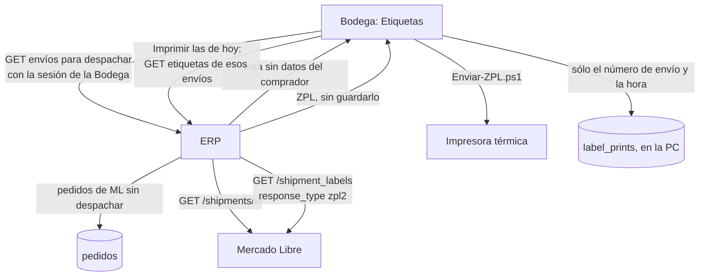

# SDD funcional · Etiquetas de Mercado Libre desde la Bodega, sin bajar archivos

## 1. Objetivo

Agustín, el 2026-11-20, sobre las mejoras a Etiquetas de la Bodega: "armá el SDD con la 1 y la 2".

**La 1:** bajar las etiquetas directo de Mercado Libre, sin pasar por el navegador.
**La 2:** ver qué hay que despachar hoy.

Hoy el recorrido es este:
1. Entrar a Mercado Libre en el navegador.
2. Bajar el ZPL.
3. Volver a la Bodega, que lo encuentra en Descargas.
4. Imprimir.
5. El archivo queda en la PC con los datos del comprador, salvo que se haya tildado "borrar después".

El ERP ya sabe qué envíos hay, cuáles son Flex y para cuándo hay que despacharlos. La Bodega no se entera de nada de eso.

Cuando esto esté en producción, la página Etiquetas de la Bodega abre con:
- **Para despachar:** los envíos de hoy y de mañana, con los Flex y su hora límite aparte, y cuáles ya se imprimieron.
- **Imprimir las de hoy:** primero las Flex, después el resto. Las etiquetas se piden a ML en el momento y van a la impresora sin guardarse en disco.

Lo de hoy (buscar el ZPL en Descargas o elegir un archivo) queda como respaldo.

### Lo que no hace falta (Agustín, 2026-11-20)

- **Las etiquetas de la web** ya se generan solas en la web en cada pedido.
- **La lista de armado** sobra: las etiquetas de ML ya traen el **troquel**, la parte chica de arriba con el producto y la variante. Es la preferencia "Imprimir troquel" de la cuenta de ML, que está prendida.

## 2. Actores y permisos

| Actor | Qué puede hacer |
|---|---|
| Agustín y Twai, en la Bodega con su sesión | Ver qué hay que despachar e imprimir las etiquetas |
| El ERP | Pedirle a ML el estado de los envíos y las etiquetas, con el token de la cuenta |
| Cualquier otro | Nada. Las etiquetas traen nombre, documento y dirección del comprador |

## 3. Flujos

### 3.1 Abrir Etiquetas
1. La Bodega le pide al ERP los envíos para despachar.
2. El ERP toma los pedidos de ML no entregados ni cancelados y le pregunta a ML el estado de cada envío.
3. Se ve una lista por día de despacho (hoy, mañana, después). En cada envío:
   - el número de venta;
   - si es **Flex**, con su hora límite;
   - si la etiqueta está **lista**, **ya impresa** o **todavía no la libera ML** (a pedido, en fabricación).
   - Sin datos del comprador: el producto sale del ERP.
4. Arriba, un resumen: "Hoy: 3 Flex antes de las 13:00 y 6 normales; ya impresas 2".

### 3.2 Imprimir las de hoy
1. "Imprimir las de hoy" pide las etiquetas listas de hoy que no se imprimieron. Avisa cuántas son y si alguna es de mañana.
2. La Bodega le pide al ERP el ZPL de esos envíos, primero los Flex.
3. Lo manda a la impresora con lo de siempre: `Enviar-ZPL.ps1`, corrimiento y aviso si no entra.
4. El ZPL vive en memoria. Si hace falta un archivo para el script, es temporal y se borra.
5. En la lista quedan marcadas como impresas.
6. También se puede imprimir **una sola**, **sólo las Flex** o **reimprimir** una.

## 4. Reglas de negocio

- **RN-1. Los datos del comprador no se guardan.**
  - Ni en el ERP (ni en logs) ni en la Bodega.
  - El ZPL va de ML a la impresora pasando por memoria.
  - El historial guarda el número de envío, la cantidad y la hora.
- **RN-2. Primero las Flex.** "Imprimir las de hoy" manda primero las Flex, para despacharlas aparte, como hoy con los botones Flex y Resto.
- **RN-3. ML manda.**
  - Lo que se ve es el estado de ML en el momento.
  - Bajar la etiqueta por la API la marca como impresa en ML, igual que bajarla en la web (se verifica en la TASK-001).
  - El ERP no cambia el estado de ningún pedido.
- **RN-4. Lo de hoy sigue.** Buscar en Descargas y elegir un archivo quedan como respaldo, por si el ERP o ML no contestan.
- **RN-5. Sólo Sendero 3D.** El endpoint sólo atiende a usuarios del taller, con su sesión.

## 5. Pantallas

| Pantalla | Qué muestra | Qué permite |
|---|---|---|
| Bodega › Etiquetas | Para despachar: resumen del día, lista por fecha de despacho; abajo, los archivos de Descargas como hoy | Imprimir las de hoy, sólo las Flex, una sola o reimprimir; el resto, como hoy |

## 6. Specs

| Spec | Qué define |
|---|---|
| 001 Prueba con ML | Bajar por la API una etiqueta real que Agustín va a imprimir igual y compararla con la de la web: troquel, Flex, medidas, si queda marcada como impresa |
| 002 ERP | `GET /api/bodega/envios` y `GET /api/bodega/etiquetas`, con la sesión de la Bodega |
| 003 Bodega | "Para despachar" e "Imprimir las de hoy", con la impresión que ya existe |

## 7. Fuera de alcance

- **Cambiar el estado de los pedidos del ERP al imprimir.** Puede venir después, pero cambia la máquina de estados.
- **Etiquetas de la web y de venta directa:** las hace la web.
- **Ver la etiqueta como imagen:** necesitaría un servicio de afuera (Labelary) y mandarle los datos del comprador. No.
- Lo que no es imprimir: avisos en el celular, cerrar envíos en ML.

## 8. Dependencias

- La cuenta de ML conectada en el ERP, con su token. Hoy se leen los envíos con él.
- La sesión de Supabase de la Bodega, la misma con la que sincroniza.
- Bodega 2.41: es una versión nueva.

## 9. Decisiones tomadas

| Fecha | Decisión | Por qué | Quién |
|---|---|---|---|
| 2026-11-20 | Sólo la 1 y la 2 | La web ya hace sus etiquetas y las de ML ya traen el troquel con producto y variante | Agustín |
| 2026-11-20 | La lista sale de los pedidos del ERP, más el estado de ML en el momento | El ERP ya tiene el número de envío y la fecha de despacho; ML dice si la etiqueta está lista o impresa | Agustín |
| 2026-11-20 | La Bodega llama al ERP con su sesión (`Authorization: Bearer`) | Es la sesión que ya usa para sincronizar; no hace falta otra clave | Agustín |
| 2026-11-20 | **Sólo la cuenta Sendero 3D.** Sendero Shop no se lista | Desde esa PC se imprimen sólo esas | Agustín |
| 2026-11-20 | **"Imprimir las de hoy"** imprime las de hoy; si las de mañana ya están listas, avisa y ofrece sumarlas | Adelantar sin imprimir de más | Agustín |
| 2026-11-20 | **La prueba (TASK-001) con el próximo envío que haya que despachar**: se baja por la API, se imprime y se compara con la de la web | Bajarla la marca como impresa en ML; así no se toca nada que no se iba a imprimir igual | Agustín |

## 10. Preguntas abiertas

Ninguna: se cerraron el 2026-11-20 (ver decisiones). La TASK-001 espera el próximo envío a despachar.
