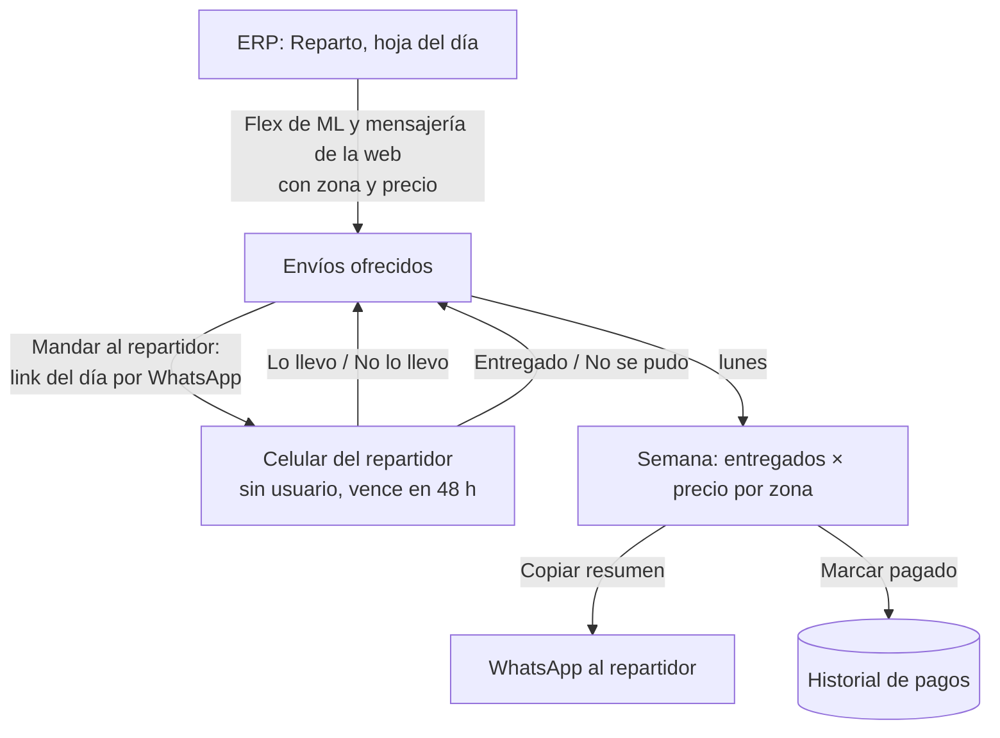

# SDD funcional · Reparto con mensajería

## 1. Objetivo

Agustín, el 2026-11-23: contrató a alguien para hacer los envíos del local, pero sólo algunos:
- los **Flex de Mercado Libre** de CABA y zona sur;
- la **mensajería de la web** de CABA y zona sur;
- a veces alguno de zona norte.

Necesita juntar los pedidos del día de Flex y de mensajería de la web, mandárselos, que él marque cuáles toma y cuáles no, y saber **todos los lunes cuánto hay que pagarle**. "Si pensás más cosas, decime."

Cuando esto esté en producción:
1. **Agustín**, en el ERP, ve los envíos del día con la zona y el precio de cada uno, elige cuáles ofrecer y le manda un link por WhatsApp.
2. **El repartidor**, desde el **celular** (decisión de Agustín: lo usa principalmente desde ahí), abre el link sin usuario.
   - Ve dirección, zona y la hora límite de cada envío.
   - Marca **"Lo llevo"** o **"No lo llevo"**, y después **"Entregado"** o **"No se pudo entregar"**.
3. **El lunes**, el ERP muestra la semana: los entregados por zona, el total a pagar y el detalle.
   - Se marca como pagada y queda el historial.
   - También dice **cuánto te dejó cada envío**: la bonificación Flex de ML o lo que cobró la web, menos lo que se le paga.

## 2. Actores y permisos

| Actor | Qué puede hacer |
|---|---|
| Agustín y Twai (ERP) | Armar la hoja del día, mandar el link, ver las respuestas, editar zona o precio de un envío, liquidar y marcar pagado, editar las tarifas |
| El repartidor (link del día, sin usuario) | Ver los envíos que se le ofrecieron ese día y marcarlos. Nada más del ERP |

## 3. Flujos

### 3.1 La hoja del día
1. Reparto en el ERP junta los envíos para despachar ese día que se pueden mandar con él:
   - los **Flex** de ML (cuenta Sendero 3D);
   - los pedidos de la web con **mensajería (SyB)**.
2. Cada uno trae su **zona**, sacada de la dirección:
   - CABA por la provincia;
   - el GBA por código postal y localidad, con la misma tabla de zonas que usa la web para cobrar la mensajería.
   - Se puede corregir a mano.
3. Cada zona tiene su **precio del repartidor** (sección 4).
4. Por defecto vienen **todos tildados** (decisión de Agustín). Agustín destilda los que no van y toca **"Mandar al repartidor"**: se abre WhatsApp con el link del día listo.
5. Si aparece un envío nuevo después (otra venta Flex), se suma a la hoja con el mismo link.

### 3.2 El repartidor, en el celular
1. Abre el link y ve la lista ordenada por zona.
   - En cada envío: nombre, dirección con la localidad al lado (botón a Google Maps) y la hora límite si es Flex. El producto no (2026-11-23).
2. Toca **"Lo llevo"** o **"No lo llevo"** en cada uno.
3. Después de la vuelta, en los que llevó: **"Entregado"** o **"No se pudo"**, con un motivo corto opcional.
4. Arriba ve cuántos lleva hoy y cuánto suma la semana. Lo cobra el lunes.
5. El link vence a las 48 horas. Pasado eso dice "Este link ya venció".

### 3.3 Liquidación del lunes
1. Reparto › Semana muestra la semana de lunes a domingo:
   - los **entregados** por zona, con cantidad × precio y el total;
   - los **no entregados**, que no se pagan.
2. **"Copiar resumen"** arma el texto para WhatsApp: "Semana del 17 al 23/11: 6 CABA × $4.000, 3 Sur × $5.800… Total $41.400".
3. **"Marcar pagado"** con la fecha. Queda en el historial y la semana se cierra.
4. **"Cuánto te dejó"**, por envío y en total:
   - Flex: la bonificación de ML menos el pago;
   - web: lo que cobró la web por la mensajería menos el pago.

## 4. Reglas de negocio

- **RN-1. Se paga lo entregado** (decisión de Agustín). "Lo llevo" sólo reserva el envío; si no se pudo entregar, no se paga.
- **RN-2. Precio por zona**, con la lista de SyB Logística (2026-11-23):

| Zona | Precio | Partidos y localidades |
|---|---|---|
| CABA | $4.000 | Ciudad de Buenos Aires |
| 1 | $5.800 | San Fernando, San Isidro, Vicente López, San Martín, 3 de Febrero, Hurlingham, Ituzaingó, Morón, La Matanza (norte), Avellaneda, Lanús, Lomas de Zamora |
| 2 | $8.200 | Tigre, Malvinas Argentinas, José C. Paz, San Miguel, Moreno, Merlo, La Matanza (sur), Quilmes, Berazategui, Florencio Varela, Almirante Brown, Esteban Echeverría, Ezeiza |
| 3 | $9.100 | Zárate, Campana, Escobar, Pilar, Luján, Gral. Rodríguez, Marcos Paz, Guernica, Korn, Tristán Suárez, Cañuelas, San Vicente, Ensenada, Berisso, La Plata |

  - Los precios se editan en el ERP.
  - El precio queda **fijo en cada envío** al ofrecerlo: si mañana cambia la tarifa, lo de esta semana no cambia.
- **RN-3. La zona se puede corregir a mano.** La Matanza está partida entre las zonas 1 y 2, y algunos códigos postales son de borde.
- **RN-4. El link del repartidor ve sólo lo necesario**: los envíos que se le ofrecieron ese día, con nombre y dirección. Sin el producto, sin precios de venta, sin otros pedidos, sin nada más del ERP.
  - El link vence a las 48 h.
  - Las direcciones de los Flex se leen de ML en el momento, no se guardan.
- **RN-5. Nada se cambia en ML ni en la web.** Marcar "Entregado" acá es para pagarle. La entrega Flex la marca él en la app de ML; la liquidación cruza los Flex "Entregado" con el estado del envío en ML (`delivered`) y muestra los que no coinciden.
- **RN-6. Pensado para el celular**: botones grandes, una mano, sin zoom, y que ande con señal floja.

## 5. Pantallas

| Pantalla | Quién | Qué muestra | Qué permite |
|---|---|---|---|
| ERP › Reparto (hoy) | Agustín y Twai | Envíos del día por zona, con precio y respuesta del repartidor | Tildar, corregir zona, mandar el link, ver respuestas en vivo |
| ERP › Reparto (semanas) | Agustín y Twai | Cada semana: entregados por zona, total, "cuánto te dejó", pagado o no | Copiar resumen, marcar pagado |
| ERP › Reparto (tarifas) | Agustín y Twai | Las cuatro zonas con su precio | Editar precios |
| `/reparto/{link}` | El repartidor, en el celular | Sus envíos de hoy, con lo que lleva hoy y en la semana | Lo llevo / No lo llevo / Entregado / No se pudo |

## 6. Specs

| Spec | Qué define |
|---|---|
| 001 Zonas y tarifas | La tabla de zonas (partidos, localidades y códigos postales, como la de la web) y el precio del repartidor |
| 002 Hoja del día | Qué envíos entran, cómo se arma el link, qué ve el repartidor |
| 003 Página del repartidor | Móvil primero, marcar y ver su semana |
| 004 Liquidación | Semana de lunes a domingo, resumen, pagado, cuánto te dejó |

## 7. Fuera de alcance

- **La app Envíos Flex de ML**, que es de ML y no hace falta "dar de alta" a nadie (2026-11-23):
  - el repartidor la baja con su cuenta, escanea las etiquetas en el local y toca "Empezar a repartir" antes de irse;
  - si escanea lejos del local, necesita el código de autorización del vendedor (Preferencias de venta › Código de autorización).
  - Sus entregas Flex quedan marcadas en ML.
- **Pagarle desde el ERP.** El ERP calcula y anota; el pago lo hace Agustín.
- **Ruta optimizada en Google Maps:** no se pidió para la primera versión.
- **Correo Argentino y retiro en el local:** no van con él.

## 8. Dependencias

- SDD 017: la lista de Flex para despachar (`envios-para-despachar.ts`) ya sabe qué Flex hay y para cuándo.
- La web manda la dirección en cada pedido (`direccion_envio`). Hoy el ERP la guarda sólo en el cliente, y sólo si estaba vacía: hay que guardarla en el pedido. Es un cambio en el ERP, no en la web.
- SDD 007: la bonificación Flex de cada envío (`flex_ml`), para "cuánto te dejó".

## 9. Decisiones tomadas

| Fecha | Decisión | Por qué | Quién |
|---|---|---|---|
| 2026-11-23 | Se paga lo **entregado** | Lo que no llegó no se paga | Agustín |
| 2026-11-23 | **Link del día por WhatsApp**, sin usuario, vence en 48 h | Simple para él; el ERP no tiene permisos por usuario | Agustín |
| 2026-11-23 | Extra: **cuánto te deja cada envío** | Saber si Flex o la mensajería en cada zona conviene | Agustín |
| 2026-11-23 | Precios por zona: los de SyB Logística (imagen) | Es la lista del repartidor | Agustín |
| 2026-11-23 | **Móvil primero** en la página del repartidor | La va a usar principalmente desde el celular | Agustín |
| 2026-11-23 | El repartidor es **otra persona** (no SyB), que cobra con la lista de SyB | La web sigue cobrando lo suyo; "cuánto te dejó" en la web es lo cobrado menos el pago | Agustín |
| 2026-11-23 | En la hoja vienen **todos tildados** | Se destilda lo que no va | Agustín |
| 2026-11-23 | **Agustín y Twai** usan Reparto (hoja, link, liquidar) | Los dos despachan | Agustín |
| 2026-11-23 | **Un link por día de despacho**, que se puede mandar el día antes; vale hasta el final del día siguiente | Que el repartidor vaya eligiendo | Agustín |
| 2026-11-23 | **El repartidor no ve el producto**, y la localidad va al lado del número | No le hace falta | Agustín |
| 2026-11-23 | **La fecha de la web es la estimada** (pedido + 3 días hábiles) y se mueve a mano | La web no manda fecha prometida | Agustín |

## 10. Preguntas abiertas

Ninguna: se cerraron el 2026-11-23 (ver decisiones).
